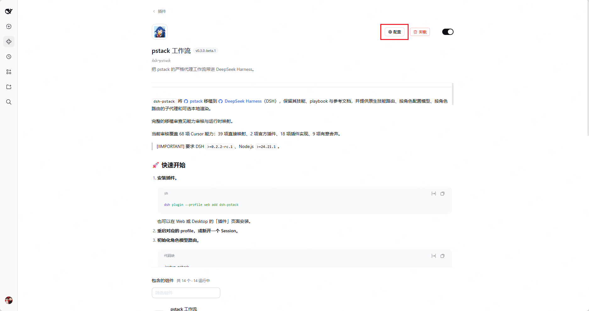
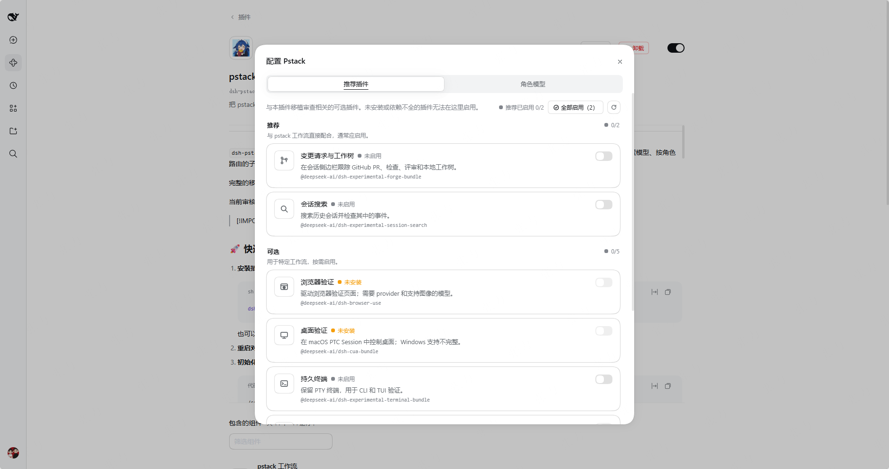
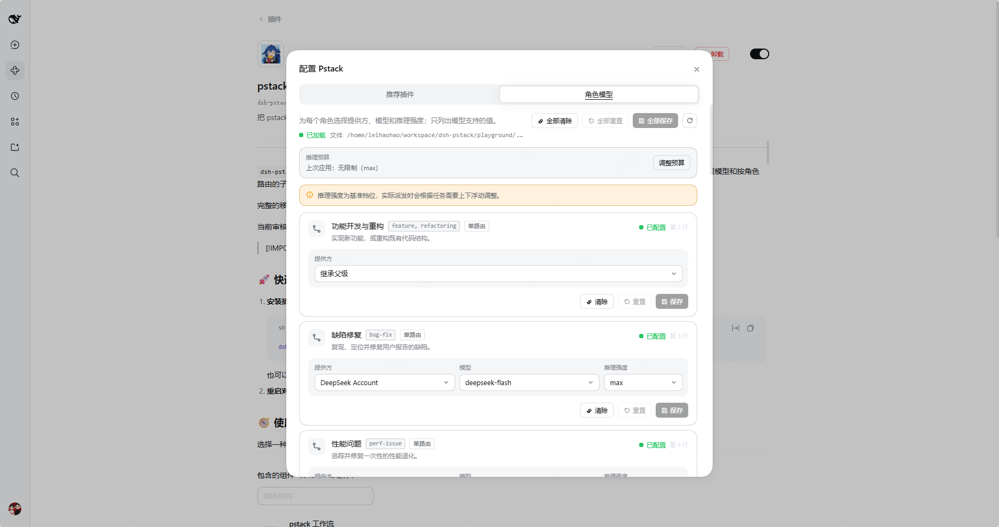
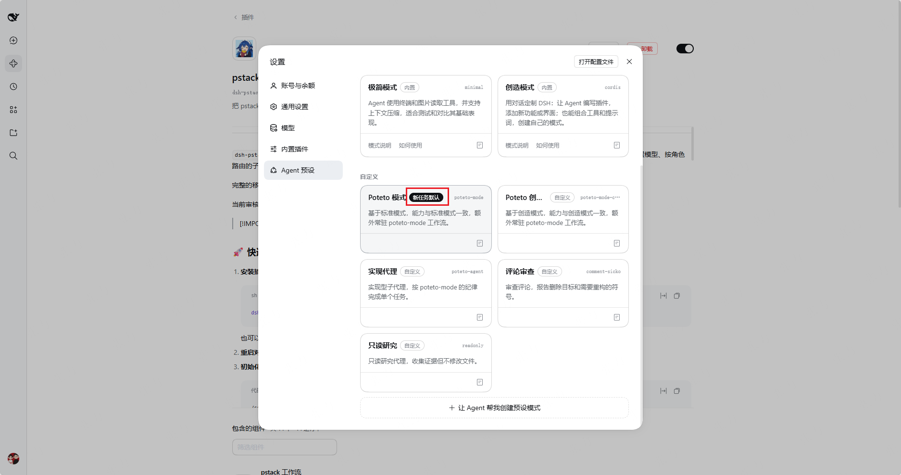
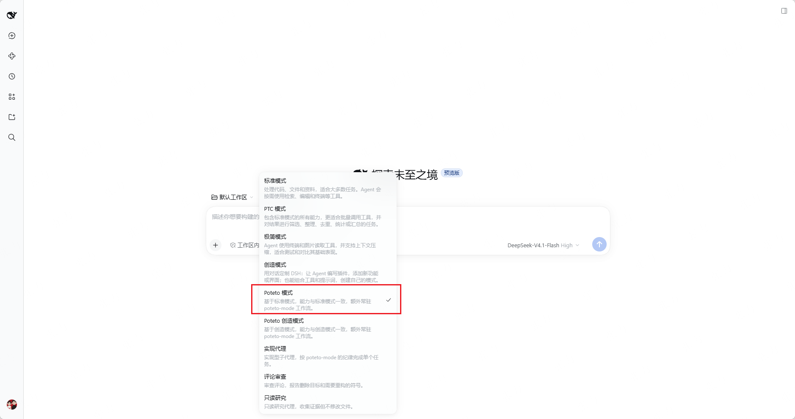

<div align="center">
  

  <h1>dsh-pstack</h1>

  <p>
    <strong>Bring pstack's rigorous agent workflows to DeepSeek Harness</strong>
  </p>

  <p>English · <a href="./README.zh.md">中文</a></p>

  <p>
    <a href="https://npmx.dev/package/@paipaipai666/dsh-pstack"></a>
    <a href="https://github.com/deepseek-ai/deepseek-harness">=0.2.2-rc.1" /></a>
    <a href="https://github.com/cursor/plugins/tree/main/pstack"></a>
    <a href="https://github.com/paipaipai666/dsh-pstack/blob/fork/main/LICENSE"></a>
    <a href="https://github.com/paipaipai666/dsh-pstack"></a>
  </p>

  <table>
    <tr>
      <td align="center"><strong>58</strong><br /><sub>pstack skills</sub></td>
      <td align="center"><strong>23</strong><br /><sub>playbooks</sub></td>
      <td align="center"><strong>6</strong><br /><sub>native tools</sub></td>
      <td align="center"><strong>5</strong><br /><sub>agent presets</sub></td>
      <td align="center"><strong>5</strong><br /><sub>bundled scripts</sub></td>
    </tr>
  </table>

  <p>
    <a href="#quick-start">🚀 Quick start</a> ·
    <a href="#️-common-commands">⌨️ Commands</a> ·
    <a href="#-capabilities">🧩 Capabilities</a> ·
    <a href="#-optional-dsh-plugins">🔌 Optional plugins</a> ·
    <a href="#️-remaining-gaps">⚠️ Limitations</a> ·
    <a href="#-faq">❓ FAQ</a> ·
    <a href="#-compatibility">📦 Compatibility</a>
  </p>
</div>

---

`dsh-pstack` ports [pstack](https://github.com/cursor/plugins/tree/main/pstack) to [DeepSeek Harness](https://github.com/deepseek-ai/deepseek-harness) (DSH). It includes the upstream skills, playbooks, and references, and adds skill routing, role-based model configuration, and role-routed subagents.

> [!NOTE]
> This is the community fork [`paipaipai666/dsh-pstack`](https://github.com/paipaipai666/dsh-pstack), rebased on upstream `0.3.1`. On top of the port it adds a `pstack_script` launcher so the bundled workflows run under the Host's own Node (the Desktop app has no `node` on PATH), a `pstack_doctor` prerequisite check, and a runtime translation layer that rewrites the Cursor names still present in the upstream skill text. See [FORK.md](./FORK.md) for the full delta.
See the [capability audit (in Chinese)](./port/audit.md) and [runtime mapping](./port/dsh.md) for the full porting review.

The current review covers 68 Cursor-facing capabilities: 39 direct mappings, 2 official plugins, 16 plugin implementations, and 11 deliberate omissions.

> [!IMPORTANT]
> Requires DSH `>=0.2.2-rc.1` and Node.js `>=24.21.0`. See the [script registry (in Chinese)](./port/AGENTS.md#脚本登记) for the extra runtime requirements of bundled workflows.

<a id="quick-start"></a>

## 🚀 Quick start

1. **Install the plugin.**

   ```sh
   dsh plugin --profile web add @paipaipai666/dsh-pstack
   ```

   You can also install it from the **Plugins** page in Web or Desktop.

2. **Restart the profile or open a new Session.**

## 🧭 Usage

Choose one of the two paths and expand it for the complete steps.

<details>
<summary><strong>🖥️ Visual setup</strong></summary>

Use the plugin UI when you want to configure related plugins and role routes.

1. Open **Plugins → Installed plugins**, select **pstack**, then click **Configure**.

   

2. In **Recommended plugins**, review the **Recommended**, **Optional**, and **Conflicts** groups. **Enable all** only enables plugins in the **Recommended** group.

   

3. Open **Role models**, set the provider, model, and reasoning effort for each role, then save the changed row or use **Save all**.

   

4. Open **Settings → Agent presets**, select **Poteto mode** or **Poteto Creator mode**, and click **Set as default**.

   

5. When creating a Session, keep the default preset or select **Poteto mode** manually.

   

</details>

<details>
<summary><strong>🧠 Skill usage</strong></summary>

Use pstack skills when you want to start workflows directly from a Session.

1. **Initialize role routes.** Run `/setup-pstack` once. It writes the detected routes to `$DSH_HOME/pstack-models.mdc`. Without this file, roles inherit the parent model.
2. **Start through skills.** Type `/poteto-mode` directly. A preset switch is not required first.
3. **Use targeted commands.** Pick a command from [Common commands](#️-common-commands).

</details>

## ⌨️ Common commands

| Task | Commands |
|---|---|
| Help | `/poteto-help` |
| Plan and build | `/poteto-mode`, `/architect`, `/arena`, `/swarm` |
| Understand and investigate | `/how`, `/why`, `/teach` |
| Verify | `/create-verification-skill`, `/statechart` |
| Review and maintain | `/show-me-your-work`, `/retro`, `/docs-drift` |

## 🗂️ Repository layout

| Path | Contents |
|---|---|
| `src/` | Plugin sources: tools, roles, presets, the client UI, and the fork's `script`, `script-policy`, `doctor`, and `native-text` modules. |
| `pstack/` | Generated pstack tree, committed for review. `port/generate.mjs` rewrites the whole directory, so no hand-written file belongs there. |
| `port/` | Porting tools and review material: the generator, the capability scan, the adapter text (`dsh.md`), and the audit. |
| `runtime/` | Sources of the five bundled scripts, compiled into `dist/pstack/skills/*/scripts` at build time. |
| `skills/authored/` | Skills that only exist in this fork. |
| `skills/.agents/skills/` | Skills vendored from other repositories and shipped with the package. |
| `.agents/skills/` | Skills this repository uses for its own agents, synced from `package.json#skills`. |
| `dist/` | Build output. Ignored by Git; created by `pnpm exec vp run build`. |
| `upstream/cursor-plugins` | Git submodule pinned to the pstack source commit. Empty until `git submodule update --init`; only regenerating the tree needs it. |

`docs/fork/` keeps the fork's own status, backlog, audit, and review notes.
## 🧩 Capabilities

### 🛠️ Native tools

| Tool | Function |
|---|---|
| `pstack_skill` | Loads hidden pstack skills by name, including resources at paths relative to the skill directory. |
| `pstack_models` | Lists available providers, models, and reasoning efforts. |
| `pstack_roles` | Shows each role's type and whether it is an automatic panel, so delegation uses the correct parameters. |
| `pstack_subagent` | Applies role routing and agent presets. Supports parallel subagents. |

### 🎭 Agent presets

The package ships two root presets and three child presets.

| Preset | Scope | Use |
|---|---|---|
| `poteto-mode` | Root | Based on Standard mode, with the same capabilities plus the persistent `poteto-mode` workflow. |
| `poteto-mode-creator` | Root | Based on Creator mode, with the same capabilities plus the persistent `poteto-mode` workflow. |
| `poteto-agent` | Child | Handles implementation delegation with the pstack persona and `poteto-mode` instructions. |
| `comment-sicko` | Child | Handles read-only comment review and reports deletion targets and `MUST KILL` symbols. |
| `readonly` | Child | Provides sandbox-enforced read-only research for inspection and evidence gathering. |

Open **Settings → Agent presets** and click **Set as default** on the preset that new Sessions should use.

### 📚 Additional skills

These skills extend pstack with authoring, project-maintenance, and evidence-gathering workflows.

| Skill | Source | Use it to |
|---|---|---|
| `writing-for-agents` | `vendored` | Write or review a skill, `AGENTS.md`, `CLAUDE.md`, or another agent-facing document, including the `create-skill` use case. |
| `retro` | `vendored` | Review a coding session's environment for improvements to navigation, checks, conventions, tools, and information access. |
| `deslop` | `vendored` | Clean unnecessary comments, defensive code, casts, and nesting from a diff without changing behavior. |
| `control-ui` | `vendored` | Drive a local Web, IDE, or Electron interface and capture visual or accessibility evidence. |
| `control-cli` | `vendored` | Drive an interactive CLI or TUI and capture terminal transcripts or performance evidence. |
| `decision-write` | `authored` | Record a design choice, its rationale, and its implementation evidence through a traceable lifecycle. |
| `decision-audit` | `authored` | Check decision-record status, scope, implementation anchors, and supersession as design history grows. |
| `setup-project-docs` | `authored` | Establish architecture, glossary, decision conventions, and pointers for a project's documentation. |
| `docs-drift` | `authored` | Audit maintained documentation and repair approved drift, redundancy, and unsupported claims. |

[`skills/skills-lock.json`](./skills/skills-lock.json) records the sources and hashes of vendored skills.

## 🔌 Optional DSH plugins

Install dsh-pstack without these plugins, then enable only the capabilities you need.

| Use case | Plugin | What it provides and its boundaries |
|---|---|---|
| Worktrees and GitHub PRs | `@deepseek-ai/dsh-experimental-forge-bundle` | Local worktrees and GitHub PR workflows. GitHub status requires a logged-in `gh`; otherwise use `gh` and `git worktree add` through `bash`. |
| Session history | `@deepseek-ai/dsh-experimental-session-search` | Read-only history and event inspection. Matches Sessions by exact `cwd`; whether subagent transcripts are included is unconfirmed. |
| Browser verification | `@deepseek-ai/dsh-browser-use` plus one provider below | Browser navigation, input, and screenshots. One provider per Session; screenshots require an image-capable model. |
| Desktop verification | `@deepseek-ai/dsh-cua-bundle` | macOS desktop control in PTC desktop-control sessions. Windows support is incomplete. |
| Persistent terminals | `@deepseek-ai/dsh-experimental-terminal-bundle` | Persistent shell and REPL sessions for CLI and TUI verification. |
| MCP integrations | `@deepseek-ai/dsh-mcp-client` | Tools from explicitly configured MCP servers; no server is configured by default. |
| Autonomous loops | `@deepseek-ai/dsh-experimental-ralph-bundle` | A foreground loop that starts a fresh child each round, rather than a persistent Session loop or event watcher. |
| Agent Teams (incompatible) | `@deepseek-ai/dsh-experimental-agent-team-profile` | Lead and teammate roles and a shared task board. Do not enable it in a profile that offers the pstack root presets; both own delegation and coordination, and the pstack root preset fails at startup while the Agent Teams service is present. |

For browser verification, choose one provider:

- `@deepseek-ai/dsh-experimental-browser-use-stagehand-native`: also requires Chromium and a supported non-DeepSeek model.
- `@deepseek-ai/dsh-experimental-browser-use-playwright-mcp`
- `@deepseek-ai/dsh-experimental-browser-use-chrome-devtools-mcp`

Enable packages through **Plugins → Add plugin**, then restart the profile when required. Most packages ship with DSH; `@deepseek-ai/dsh-cua-bundle` installs on demand. All except the MCP client are experimental.

> [!WARNING]
> **Agent Teams conflicts with the pstack root presets.** Use either Agent Teams or `pstack_subagent`, not both. Enabling Agent Teams makes the pstack root preset fail at startup and disables DSH native subagent tools.

Steps that depend on a disabled plugin report skipped or blocked, never passed. See the [DSH adaptation guide](./pstack/docs/harness/dsh.md#optional-plugins) for setup and fallbacks.

## ⚠️ Remaining gaps

These limitations remain even after all optional plugins that can coexist with pstack are enabled.

| Area | Limitation |
|---|---|
| Cursor platform services | No Automations, Cursor webhooks, `SendToUser`, cloud agents, or persistent cloud Projects. |
| Bugbot | Cannot start, configure, or wait for Bugbot. Existing Bugbot comments can still be handled as PR reviews. |
| PR orchestration | No model-side change-request tool or Agent Teams-style PR tracking board and shared ledger. `watch-pr` still provides stack verdicts. |
| Mode switching | No Option+Enter toggle or mid-session mode switch. Select `poteto-mode` or `poteto-mode-creator` at session creation; other presets invoke `/poteto-mode` for each task. |
| Event-driven loops | No forge event subscription. Local goals, schedules, and watchers are not equivalent. |
| Diagram rendering | No built-in renderer. Charts return Mermaid text; render an image with your own tools when needed. |
| Media evidence | No built-in video rendering, recording, or frame-level verification. Use external recording or FFmpeg tools. |
| Desktop coverage | Computer use is limited to macOS PTC desktop-control sessions. Windows support is incomplete. |
| MCP discovery | No automatic evidence-category discovery. Configure and identify MCP tools explicitly. |

## ❓ FAQ

<details>
<summary><strong>Expand for questions and answers</strong></summary>

1. **Agent preset names stay in English**

   Set the language to Chinese in **Settings → General → Language**, then restart DSH. If the row already shows Chinese, select it again to save the preference that preset names read when the host starts.

</details>

## 📦 Compatibility

Choose a release by its declared DSH range. Within each compatibility range, every `x.y` keeps only its latest release. The pstack column records the current port baseline, not a per-release history.

<!-- compatibility-keys: ["dsh-0.2.2-rc.1+port-v1","dsh-0.2.1-rc.5+legacy-v1","dsh-0.2.0-0.3.0+legacy-v1"] -->
| DSH version | dsh-pstack release | Included pstack version |
|---|---|---|
| `>=0.2.2-rc.1` | `0.4.0-beta.1` | `0.15.36` |
| `>=0.2.1-rc.5` | `0.2.2` | `0.15.36` |
| `>=0.2.0 < 0.3.0` | `0.1.0` | `0.15.29` |


A new compatibility range adds a row. Other releases update their row automatically; see [Porting](./port/AGENTS.md#破坏性变更).

## 🔗 Friendly Links

- [LinuxDo - 新的理想型社区](https://linux.do/)

## 💛 Credits

- [pstack](https://github.com/cursor/plugins/tree/main/pstack), designed and open-sourced by Lauren Tan and the Cursor team; the foundation of this port.
- [DeepSeek Harness](https://github.com/deepseek-ai/deepseek-harness), developed by the DeepSeek team; the host platform for this plugin.
- [cursor-team-kit](https://github.com/cursor/plugins/tree/main/cursor-team-kit), the source of the vendored `deslop`, `control-ui`, and `control-cli` skills.
- [mattpocock/skills](https://github.com/mattpocock/skills), the source of the vendored `writing-for-agents` and `retro` skills.

This project is a community port, not an official Cursor or DeepSeek release.

## 📄 License

Original dsh-pstack code and documentation use the [MIT license](./LICENSE) © [leiwang](https://github.com/l246804). Bundled upstream projects and vendored skills are used under their upstream licenses; see [Credits](#-credits).
