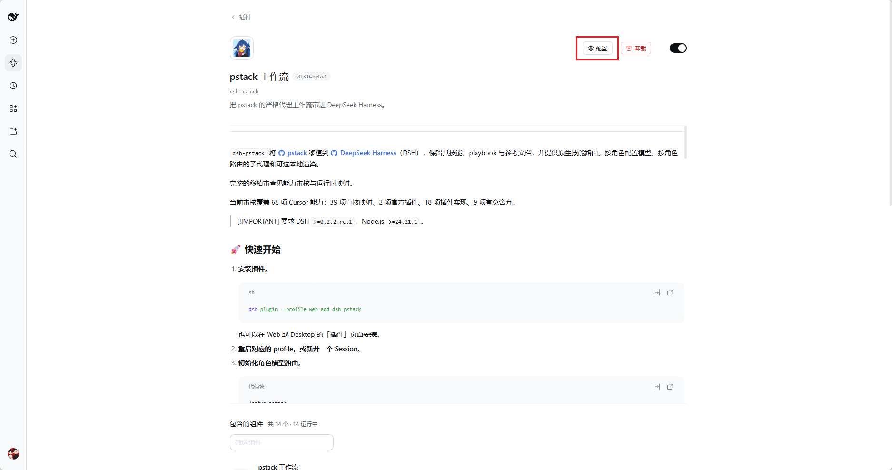
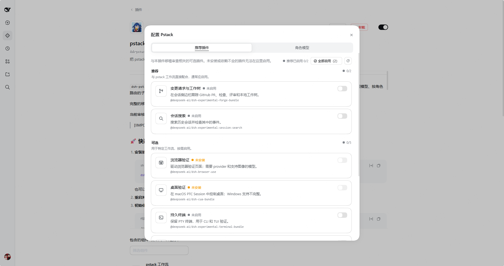
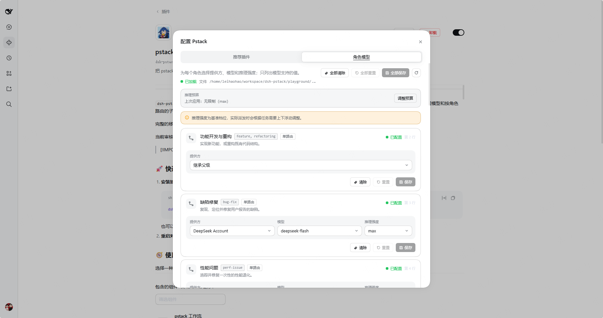
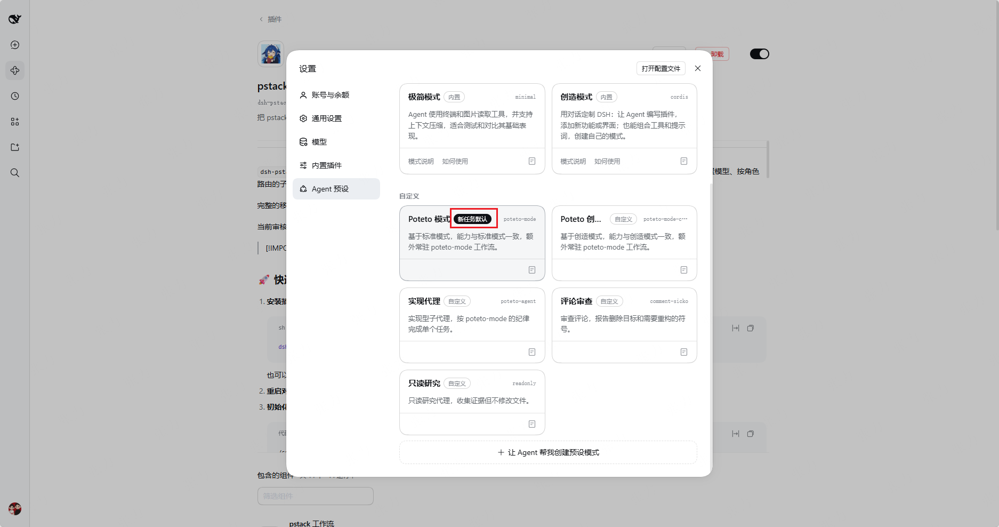
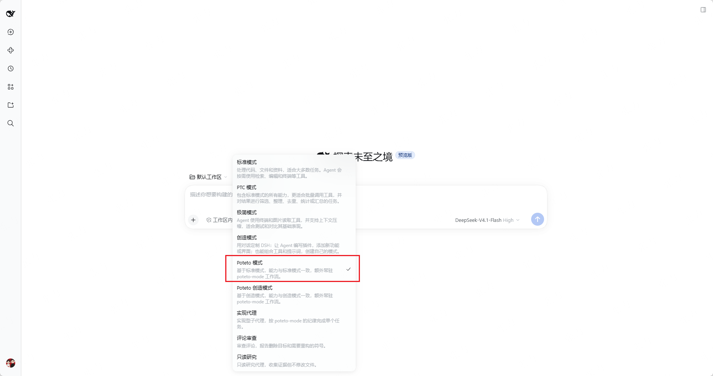

<div align="center">
  

  <h1>dsh-pstack</h1>

  <p>
    <strong>把 pstack 的严格代理工作流带进 DeepSeek Harness</strong>
  </p>

  <p><a href="./README.md">English</a> · 中文</p>

  <p>
    <a href="https://npmx.dev/package/@paipaipai666/dsh-pstack"></a>
    <a href="https://github.com/deepseek-ai/deepseek-harness">=0.2.2-rc.2" /></a>
    <a href="https://github.com/cursor/plugins/tree/main/pstack"></a>
    <a href="https://github.com/paipaipai666/dsh-pstack/blob/fork/main/LICENSE"></a>
    <a href="https://github.com/paipaipai666/dsh-pstack"></a>
  </p>

  <table>
    <tr>
      <td align="center"><strong>58</strong><br /><sub>pstack 技能</sub></td>
      <td align="center"><strong>23</strong><br /><sub>playbook</sub></td>
      <td align="center"><strong>8</strong><br /><sub>原生工具</sub></td>
      <td align="center"><strong>5</strong><br /><sub>agent preset</sub></td>
      <td align="center"><strong>4</strong><br /><sub>随包脚本</sub></td>
    </tr>
  </table>

  <p>
    <a href="#quick-start">🚀 快速开始</a> ·
    <a href="#️-常用命令">⌨️ 常用命令</a> ·
    <a href="#-能力">🧩 能力</a> ·
    <a href="#-可选-dsh-插件">🔌 可选插件</a> ·
    <a href="#️-仍存在的缺口">⚠️ 仍存在的缺口</a> ·
    <a href="#-常见问题">❓ 常见问题</a> ·
    <a href="#-兼容性">📦 兼容性</a>
  </p>
</div>

---

`dsh-pstack` 将 [pstack](https://github.com/cursor/plugins/tree/main/pstack) 移植到 [DeepSeek Harness](https://github.com/deepseek-ai/deepseek-harness)（DSH），保留其技能、playbook 与参考文档，并提供原生技能路由、按角色配置模型和按角色路由的子代理。

> [!NOTE]
> 本仓库是社区 fork [`paipaipai666/dsh-pstack`](https://github.com/paipaipai666/dsh-pstack)，基于上游 `0.3.1` 重建。除移植本身外，它还增加了这些内容：`pstack_script` 启动器（让随包工作流跑在宿主自带的 Node 上，桌面端没有 PATH 上的 `node`）、`pstack_doctor` 环境检查、把任务派发到你运行的另一台机器的 `pstack_remote`、把 statechart 与 flowchart 图渲染成 SVG 的 `pstack_chart`，以及在运行时改写上流技能文本里残留的 Cursor 名称的翻译层。完整差异见 [FORK.md](./FORK.md)。
完整的移植审查见[能力审核](./port/audit.md)与[运行时映射](./port/dsh.zh.md)。

当前审核覆盖 68 项面向 Cursor 的能力：39 项直接映射、2 项官方插件、16 项插件实现、11 项有意舍弃。

> [!IMPORTANT]
> 要求 DSH `>=0.2.2-rc.2`、Node.js `>=24.21.0`。部分随包工作流需要额外运行时，见[脚本登记](./port/AGENTS.md#脚本登记)。

<a id="quick-start"></a>

## 🚀 快速开始

1. **安装插件。**

   ```sh
   dsh plugin --profile web add @paipaipai666/dsh-pstack
   ```

   也可以在 Web 或 Desktop 的「插件」页面安装。

2. **重启对应的 profile，或新开一个 Session。**

## 🧭 使用步骤

选择一种方式，点击展开查看完整步骤。

<details>
<summary><strong>🖥️ 可视化使用步骤</strong></summary>

需要配置相关插件或角色路由时，使用插件界面。

1. 打开 **插件 → 已安装插件**，选择 **pstack 工作流**，然后点击 **配置**。

   

2. 在 **推荐插件** 中查看 **推荐**、**可选**、**冲突** 三组。**全部启用** 只会启用 **推荐** 组中的插件。

   

3. 打开 **角色模型**，为每个角色设置提供方、模型和推理强度，然后保存该行或点击 **全部保存**。

   

4. 打开 **设置 → Agent 预设**，选择 **Poteto 模式** 或 **Poteto 创造模式**，点击 **默认预设**。

   

5. 新建会话时保留默认预设，或手动选择 **Poteto 模式**。

   

</details>

<details>
<summary><strong>🧠 技能使用步骤</strong></summary>

需要从会话直接启动 pstack 工作流时，使用技能命令。

1. **初始化角色路由。** 运行一次 `/setup-pstack`。命令会把检测到的路由写入 `$DSH_HOME/pstack-models.mdc`。缺少此文件时，角色继承父级模型。
2. **通过技能启动。** 直接输入 `/poteto-mode`。不需要先切换预设。
3. **使用针对性命令。** 从[常用命令](#️-常用命令)中选择。

</details>

## ⌨️ 常用命令

| 工作流 | 命令 |
|---|---|
| 帮助 | `/poteto-help` |
| 规划与实现 | `/poteto-mode`、`/architect`、`/arena`、`/swarm` |
| 理解与调查 | `/how`、`/why`、`/teach` |
| 验证 | `/create-verification-skill`、`/statechart` |
| 审查与维护 | `/show-me-your-work`、`/retro`、`/docs-drift` |

## 🗂️ 仓库结构

| 路径 | 内容 |
|---|---|
| `src/` | 插件源码：工具、角色、preset、客户端界面，以及本 fork 的 `script`、`script-policy`、`doctor`、`native-text` 模块。 |
| `pstack/` | 生成的 pstack 树，提交进仓库以便审查。`port/generate.mjs` 会重写整个目录，因此不要在其中放手写文件。 |
| `port/` | 移植工具与审查资料：生成器、能力扫描、适配文案（`dsh.md`）与审核记录。 |
| `runtime/` | 四个随包脚本的源码，构建时编译进 `dist/pstack/skills/*/scripts`。 |
| `skills/authored/` | 仅存在于本 fork 的技能。 |
| `skills/.agents/skills/` | 从其他仓库 vendored 并随包发布的技能。 |
| `.agents/skills/` | 本仓库自身代理使用的技能，由 `package.json#skills` 同步。 |
| `dist/` | 构建产物，被 Git 忽略，由 `pnpm exec vp run build` 生成。 |
| `upstream/cursor-plugins` | 固定到 pstack 源提交的 git submodule。未执行 `git submodule update --init` 时为空；只有重新生成树才需要它。 |

`docs/fork/` 保存本 fork 自己的状态、待办、审核与复审记录。
## 🧩 能力

### 🛠️ 原生工具

| 工具 | 作用 |
|---|---|
| `pstack_skill` | 按名称或 `forPath` 路径后缀匹配（如 `.ts`/`.tsx` 对应 `typescript-best-practices`）加载隐藏的 pstack 技能，以及技能目录内相对路径的资源。 |
| `pstack_models` | 列出可用的 provider、model 和 reasoning effort。 |
| `pstack_roles` | 展示每个角色的类型、自动面板行为及 `$DSH_HOME/pstack-models.mdc` 中已配置的路由，确保委派时使用正确的参数。 |
| `pstack_subagent` | 应用角色路由与 agent preset，支持并行子代理。 |
| `pstack_script` | 在宿主自带的 Node 运行时下运行四个随包工作流之一（`watch-pr`、`worktree-audit`、`log`、`statechart`）；`worktree-audit` 省略 `--sessions` 时自动汇总活跃会话与 `$DSH_HOME/sessions` 下的 `.jsonl.zstd` 会话日志。`pstack-script-policy` 行会在每次调用前请求审批；`background: true` 把长任务交给 job 系统。 |
| `pstack_doctor` | 报告随包工作流需要的本机依赖（`git`、`gh` 含登录状态、`node`、`ffmpeg`、`mise`、`java`）、已配置的模型角色、`/why` MCP 证据类别归类、当前 profile 中可选插件的状态，以及工作区里那些 DSH 永远不会加载的 `.cursor/rules/*.mdc` 文件。 |
| `pstack_remote` | 把一次任务派发到你登记的机器，读取它的事件流，并可以停止它。本插件不提供机器：目标是 PATH 里有 `dsh` 的 SSH 主机，或流式输出 NDJSON 的 HTTP worker。 |
| `pstack_chart` | 把 `stateDiagram-v2` 与 `flowchart TD/LR` 子集渲染成独立 SVG，支持底部字幕条（`subtitle`）、自环边以及分组色板与 `breaks`/`mayBreak`/`bugPath`/`repeats` 四类状态标记叠加配色；不需要浏览器或外部二进制，读不懂的语法按行号报错，不猜。 |

### 🎭 Agent preset

随包提供两个根 preset 和三个子代理 preset。

| 预设 | 范围 | 用途 |
|---|---|---|
| `poteto-mode` | 根 | 基于标准模式，能力与标准模式一致，额外常驻 `poteto-mode` 工作流。 |
| `poteto-mode-creator` | 根 | 基于创造模式，能力与创造模式一致，额外常驻 `poteto-mode` 工作流。 |
| `poteto-agent` | 子代理 | 实现型子代理，注入 pstack 人格和 `poteto-mode` 指令。 |
| `comment-sicko` | 子代理 | 只读评论评审子代理，报告删除目标和 `MUST KILL` 符号。 |
| `readonly` | 子代理 | 带只读沙箱策略的研究子代理，用于检查和取证。 |

在 **设置 → Agent 预设** 中可以点击 **默认预设**，让新建会话自动使用该预设。

### 📚 额外技能

这些技能为 pstack 补充文档编写、项目维护和证据采集工作流。

| 技能 | 来源 | 使用场景 |
|---|---|---|
| `writing-for-agents` | `vendored` | 编写或评审技能、`AGENTS.md`、`CLAUDE.md` 等 agent 文档，覆盖 `create-skill` 的使用场景。 |
| `retro` | `vendored` | 复盘编码会话的 agent 环境，改进导航、自动化检查、编码约定、工具效率和信息获取。 |
| `deslop` | `vendored` | 在不改变行为的前提下，清理 diff 中多余的注释、防御性代码、类型断言和嵌套。 |
| `control-ui` | `vendored` | 操作本地 Web、IDE 或 Electron 界面，采集视觉或可访问性证据。 |
| `control-cli` | `vendored` | 操作交互式 CLI 或 TUI，采集终端操作记录或性能证据。 |
| `decision-write` | `authored` | 以可追踪的生命周期记录设计取舍、理由和实现证据。 |
| `decision-audit` | `authored` | 在设计历史累积后，检查记录状态、范围、实现锚点和取代关系。 |
| `setup-project-docs` | `authored` | 为项目建立架构、术语、决策约定和文档指针。 |
| `docs-drift` | `authored` | 巡检持续维护的文档，修复获批的漂移、冗余和无依据表述。 |

vendored 技能的来源与哈希记录在 [`skills/skills-lock.json`](./skills/skills-lock.json)。

## 🔌 可选 DSH 插件

安装 dsh-pstack 时无需一并安装这些插件，按需启用即可。

| 使用场景 | 插件 | 提供的能力与边界 |
|---|---|---|
| worktree 与 GitHub PR | `@deepseek-ai/dsh-experimental-forge-bundle` | 提供本地工作树和 GitHub PR 工作流。GitHub 状态需要已登录的 `gh`；没有此插件时通过 `bash` 使用 `gh` 与 `git worktree add`。 |
| 历史会话 | `@deepseek-ai/dsh-experimental-session-search` | 只读检索历史会话与事件，按 `cwd` 完全匹配；是否包含子代理会话记录尚未确认。 |
| 浏览器验证 | `@deepseek-ai/dsh-browser-use` 与下方任一 provider 搭配 | 浏览器导航、输入和截图。每个 Session 使用一个 provider，截图需要支持图像的模型。 |
| 桌面验证 | `@deepseek-ai/dsh-cua-bundle` | 在 macOS PTC 桌面控制会话中控制桌面；Windows 支持尚不完整。 |
| 持久终端 | `@deepseek-ai/dsh-experimental-terminal-bundle` | 为 CLI 和 TUI 验证提供持久 shell 与 REPL 会话。 |
| MCP 集成 | `@deepseek-ai/dsh-mcp-client` | 使用显式配置的 MCP server 工具；默认不配置 server。 |
| 自主循环 | `@deepseek-ai/dsh-experimental-ralph-bundle` | 每轮启动新子代理的前台循环，不是同一 Session 的常驻循环或事件 watcher。 |
| Agent Teams（不兼容） | `@deepseek-ai/dsh-agent-team` 和 `@deepseek-ai/dsh-tool-agent-team` | 提供 lead/teammate 角色与共享任务板。不要在提供 pstack 根预设的 profile 中启用；两者都承担委派与协调。检测到 Agent Teams 服务时，pstack 根预设会跳过持久 workflow section，改为显示冲突提示。 |

浏览器验证从以下 provider 中选择一个：

- `@deepseek-ai/dsh-experimental-browser-use-stagehand-native`：还需要 Chromium 和受支持的非 DeepSeek 模型。
- `@deepseek-ai/dsh-experimental-browser-use-playwright-mcp`
- `@deepseek-ai/dsh-experimental-browser-use-chrome-devtools-mcp`

通过 **插件 → 添加插件** 启用对应包，必要时重启 profile。多数包随 DSH 提供，`@deepseek-ai/dsh-cua-bundle` 按需安装。除 MCP client 外，以上插件均为实验性插件。

> [!WARNING]
> **Agent Teams 与 pstack 根预设冲突。** 不要在同一个 profile 中同时启用。pstack 根预设仍会加载，但会丢掉持久的 `poteto-mode` section 并显示冲突提示；Agent Teams 还会禁用 pstack 的 `send_message`、`interrupt_agent` 和 `list_agents` 控制工具。

### Agent Teams 冲突

`@deepseek-ai/dsh-agent-team` 和 `@deepseek-ai/dsh-tool-agent-team` 与 pstack 根预设都拥有派发和任务协调能力。在同一个 profile 中同时启用，会让模型收到两套互相竞争的派发路径：

- **委派入口。** pstack 使用 `pstack_subagent` 与 pstack 角色和预设。Agent Teams 使用标准 `subagent` 和 `subagent_fork` 工具与具名队友；两条路径不共享角色或预设语义。
- **控制工具。** 两者都提供 `send_message`、`interrupt_agent` 和 `list_agents`；同一 profile 中只能有一套注册占用这些工具名。
- **任务状态。** pstack 把计划放在 `todo_write` 和当前 playbook 里，Agent Teams 维护持久的 `team_task_*` 任务板。两者都会声称自己是“谁负责什么、还剩什么”的事实来源。
- **容量。** pstack `swarm` 启动一次性 worker，通过完成通知回收；Agent Teams 维护最多 256 个任务的持久团队任务板。

检测到 Agent Teams 服务时，`src/poteto-mode.ts` 会跳过持久的 `pstack:poteto-mode` section，改为注册冲突提示。根 preset 仍会加载 persona 和工具面，但它的 workflow 不再持久。这是有意降级，不是崩溃：同时挂载两套 section 会给模型两套互相竞争的派发与任务跟踪指令。

需要 Agent Teams 时，单独使用一个 profile。如果确实要在同一个会话里同时使用两者，受支持的混合方式是把 `pstack_subagent`、`pstack_skill`、`pstack_script`、`pstack_remote` 和 `pstack_chart` 当作工具箱，每个任务手动加载 `/poteto-mode`，并接受 pstack 失去 `send_message`/`interrupt_agent`/`list_agents` 控制面。

依赖未启用插件的步骤会标记为 skipped 或 blocked，不会标记为通过。安装与回退说明见 [DSH 适配文档](./port/dsh.zh.md#可选插件)。

## 🔁 从 Cursor 迁移

已经在 Cursor 里用 pstack 的项目，搬到这里前需要改四处。

| Cursor 习惯 | 在 DSH 里怎么做 |
|---|---|
| `.cursor/rules/*.mdc` 常驻规则 | 把文字搬进 `AGENTS.md`。DSH 从不加载 `.mdc`；唯一例外是角色文件，由 `pstack_subagent` 从 `$DSH_HOME/pstack-models.mdc` 读取。 |
| `claude-opus-5-5-xhigh` 这类模型 slug | 改传 `role: "<角色键>"`。先运行 `pstack_models` 看本部署实际提供的路由，再用 `setup-pstack` 写入。 |
| Task 调用里的 `environment: "cloud"` | 用 `pstack_remote` 登记一台机器并指名，或者让该步骤退回本地 worktree。DSH 不提供 VM。 |
| 图表、视频、入站 webhook | `stateDiagram-v2` 与 `flowchart` 图表不需要额外安装：`pstack_chart` 会把 `.mmd` 渲染成 SVG（支持可选底部 `subtitle` 字幕条）。其余情况装替代插件，不要改写技能：对话卡片用 `@nagi-ovo/dsh-visualize`，媒体后处理用 `dsh-ffmpeg`，入站事件用 `@deepseek-ai/dsh-webhook` 加一个 provider 适配器。 |

`pstack_doctor` 会检查当前会话的工作区，把发现的 `.cursor/rules/*.mdc` 文件逐个列出来，所以第一行不必靠记忆。自动化配方（包括无人值守怎么跑）见 [docs/automations.md](./docs/automations.md)。

## ⚠️ 仍存在的缺口

即使启用所有可与 pstack 共存的可选插件，以下限制仍然存在。

| 领域 | 限制 |
|---|---|
| Cursor 平台服务 | 不支持 Automations 面板、`SendToUser` 和持久云端 Projects。云代理映射到你自己登记的远端目标，DSH 不提供机器。 |
| Bugbot | 无法启动、配置或等待 Bugbot；已有 Bugbot 评论仍可作为 PR review 处理。 |
| PR 编排 | 没有模型侧变更请求工具，也没有 Agent Teams 式的 PR 跟踪面板与共享记录；`watch-pr` 仍提供 stack verdict。 |
| 模式切换 | 没有 Option+Enter 开关或会话中切换模式的入口。新建会话时选择 `poteto-mode` 或 `poteto-mode-creator`；其它 preset 每个任务调用 `/poteto-mode`。 |
| 事件驱动循环 | 不订阅 forge 事件。官方 `dsh-webhook` 接缝能用已验证的投递启动会话，但没有去重、没有完成回报，且只有 GitHub 适配器。 |
| 图表渲染 | `pstack_chart` 已内置 `stateDiagram-v2` 与 `flowchart TD/LR` 子集渲染（含自环边、可选 `subtitle` 字幕条、分组色板与 `breaks`/`mayBreak`/`bugPath`/`repeats` 四类叠加配色），采用自带分层布局；其他 Mermaid 图类型（如 sequence、ER、Gantt）仍没有内置渲染器，需要对话内卡片时安装 `@nagi-ovo/dsh-visualize`。 |
| 视频证据 | 没有内置视频渲染、录屏与逐帧验证，需要外部录屏或 FFmpeg 工具。 |
| 桌面覆盖 | computer use 仅支持 macOS PTC 桌面控制会话，Windows 支持尚不完整。 |
| MCP 发现 | `pstack_doctor` 会按 server/工具名启发式把已挂载的 `mcp__*` 工具归入 `/why` 证据类别，但 MCP server 本身仍需在 `@deepseek-ai/dsh-mcp-client` 中显式配置。 |

## ❓ 常见问题

<details>
<summary><strong>展开查看问题与解答</strong></summary>

1. **预设名称显示为英文**

   在「设置 → 通用 → 语言」中把语言切换为中文，然后重启 DSH。语言行可能已经显示中文，因为它跟随浏览器；重新选择一次中文会写入 preset 在 Host 启动时读取的语言偏好。

</details>

## 📦 兼容性

按发布版本声明的 DSH 范围选择。同一兼容范围内，每个 x.y 只保留最新版本。pstack 列记录当前移植基线，不逐一追溯旧插件版本。

<!-- compatibility-keys: ["dsh-0.2.2-rc.2+port-v1","dsh-0.2.2-rc.1+port-v1","dsh-0.2.1-rc.5+legacy-v1","dsh-0.2.0-0.3.0+legacy-v1"] -->
| DSH 版本 | dsh-pstack 发布版本 | 包含的 pstack 版本 |
|---|---|---|
| `>=0.2.2-rc.2` | `0.5.6` | `0.15.46` |
| `>=0.2.2-rc.1` | `0.4.0-beta.2` | `0.15.43` |
| `>=0.2.1-rc.5` | `0.2.2` | `0.15.36` |
| `>=0.2.0 < 0.3.0` | `0.1.0` | `0.15.29` |


新增兼容范围时增加一行，其他发布自动更新所属行；规则见[移植与维护](./port/AGENTS.md#破坏性变更)。

## 🔗 友情链接

- [LinuxDo - 新的理想型社区](https://linux.do/)

## 💛 鸣谢

- [pstack](https://github.com/cursor/plugins/tree/main/pstack)：由 Lauren Tan 与 Cursor 团队设计并开源，是本项目的工作流基础。
- [DeepSeek Harness](https://github.com/deepseek-ai/deepseek-harness)：由 DeepSeek 团队开发，是本插件的运行平台。
- [cursor-team-kit](https://github.com/cursor/plugins/tree/main/cursor-team-kit)：vendored `deslop`、`control-ui` 与 `control-cli` 技能的来源。
- [mattpocock/skills](https://github.com/mattpocock/skills)：vendored `writing-for-agents` 与 `retro` 技能的来源。

本项目是社区移植，不是 Cursor 或 DeepSeek 官方发行。

## 📄 License

本仓原创代码与文档采用 [MIT License](./LICENSE) © [leiwang](https://github.com/l246804)。上游项目及 vendored 技能按各自的许可证使用，详见[鸣谢](#-鸣谢)。
